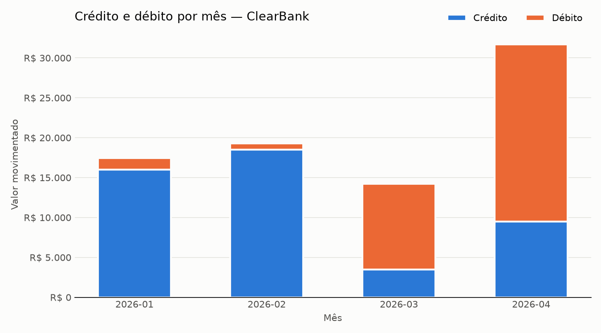

# ClearBank — Análise Financeira com Python

Desafio final do módulo de Python para análise de dados. O notebook lê o histórico de transações bancárias de `transacoes.csv`, descarta registros inválidos, calcula métricas financeiras por mês, sinaliza transações suspeitas, exibe um relatório formatado e exporta o resultado em `relatorio.json`.

A solução principal usa apenas a biblioteca padrão do Python (`csv`, `json`, `datetime`). Como extras, há uma versão alternativa com **pandas** e um gráfico com **matplotlib**.

## Estrutura

```
clearbank-analise/
├── desafio-final.ipynb   # notebook principal, com as saídas salvas
├── transacoes.csv        # dados de entrada (válidos + inválidos para teste)
├── relatorio.json        # relatório gerado pelo notebook
├── analise_pandas.py     # (opcional) versão com pandas + comparação com a nativa
├── grafico.png           # (opcional) crédito e débito por mês
└── requirements.txt
```

## Como executar

Requer **Python 3.10 ou superior**.

### Localmente (Jupyter)

```bash
python3 -m venv .venv
source .venv/bin/activate          # Windows: .venv\Scripts\activate
pip install -r requirements.txt
jupyter notebook desafio-final.ipynb
```

No Jupyter, use **Kernel → Restart & Run All** para executar todas as células em ordem.

### Google Colab

1. Abra o `desafio-final.ipynb` no [Colab](https://colab.research.google.com/) (File → Upload notebook).
2. Envie `transacoes.csv` e `analise_pandas.py` pelo painel de arquivos (ícone de pasta, à esquerda).
3. Execute **Runtime → Run all**.

pandas e matplotlib já vêm instalados no Colab.

## Regras de validação

Linhas com qualquer um dos problemas abaixo são descartadas sem interromper o processamento:

- `id` vazio, não numérico ou duplicado (mantém a primeira ocorrência);
- `cliente_id` vazio;
- `data` fora do formato `AAAA-MM-DD` ou inexistente (ex.: `2026-13-40`);
- `tipo` diferente de `credito` ou `debito`;
- `valor` não numérico ou menor ou igual a zero.

Transações com valor **acima** de `LIMITE_SUSPEITO` (R$ 10.000,00) são sinalizadas como suspeitas.

## O que o notebook gera

- **Relatório no terminal** (saída da Célula de Execução Principal): resumo da limpeza, período analisado, métricas por mês (quantidade, total de crédito e débito, saldo, média, maior e menor valor) e a lista de transações suspeitas.
- **`relatorio.json`**: o mesmo relatório em formato estruturado:

  ```json
  {
    "gerado_em": "2026-10-21",
    "periodo": { "inicio": "2026-01-05", "fim": "2026-04-28", "dias": 113 },
    "total_transacoes_validas": 18,
    "total_transacoes_invalidas": 10,
    "resumo_mensal": {
      "2026-01": {
        "quantidade": 5,
        "total_credito": 16000.0,
        "total_debito": 1470.4,
        "saldo": 14529.6,
        "media": 3494.08,
        "maior_valor": 12500.0,
        "menor_valor": 89.9
      }
    },
    "transacoes_suspeitas": [
      { "id": 4, "cliente_id": "CLI002", "data": "2026-01-22", "valor": 12500.0 }
    ]
  }
  ```

- **(Opcional) Comparação com pandas**: o `analise_pandas.py` refaz a leitura e o agrupamento com `pd.read_csv` e `groupby` e confirma que os valores são idênticos aos da solução nativa.
- **(Opcional) `grafico.png`**: barras empilhadas com crédito e débito por mês.


